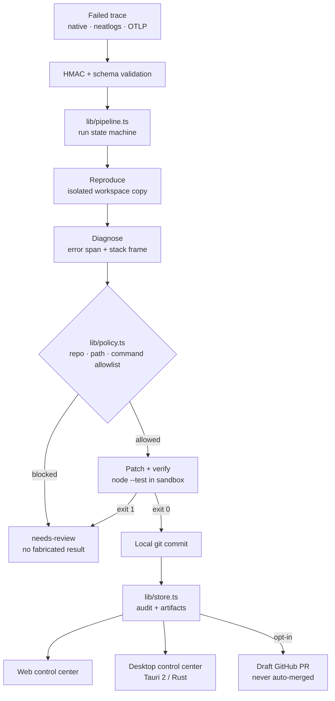

# TraceHealer

**TraceHealer turns a failed AI-run trace into a reproduced failure, a minimal policy-checked patch, and a verification-gated review artifact — and it never merges customer code.**

[](https://github.com/sumitagg24/tracehealer/actions/workflows/ci.yml)
[](https://github.com/sumitagg24/tracehealer/actions/workflows/desktop.yml)
[](LICENSE)
[](https://github.com/sumitagg24/tracehealer/releases/tag/v0.1.0-rc.1)

[Demo](#verified-demo-result) · [Unsigned preview downloads](#desktop-preview) · [Architecture](#architecture) · [Safety boundaries](#safety-boundaries) · [Release evidence](#evidence-and-tests)

> The `v0.1.0-rc.1` installers are **unsigned**. macOS builds are **not notarized**. See [Known limitations](#known-limitations).

## The problem

An agent fails in production. An engineer starts from a trace and then has to reproduce the failure, find the cause, write the patch, run the tests, and package the evidence by hand. That work is mechanical, repetitive, and easy to fake with a confident-looking "fix" that was never verified.

## What TraceHealer does

1. **Ingest** — a failed trace arrives from a webhook, the API, or a seeded incident.
2. **Reproduce** — the failure is replayed in an isolated workspace with the real failing input, not a simulation of it.
3. **Diagnose** — the stack frame is mapped onto repository context.
4. **Patch** — the smallest safe change is generated and checked against policy.
5. **Verify** — the failed input and regression checks run in isolation; a run only reports `healed` if verification passes.
6. **Package** — a draft review artifact with timeline, checks, logs, diff, and verification JSON. An engineer reviews and merges; **TraceHealer never auto-merges**.

Anything the pipeline cannot honestly fix settles as `needs-review` instead of a fabricated success.

## Verified demo result

The included scenario is deterministic and re-runnable from a clean clone — no API key, no account, no network dependency.

| Check | Result |
|---|---|
| Original failing test | exit code `1` |
| Same test after the repair | exit code `0` |
| Regression checks | `4/4` passed |
| Artifacts produced | `.patch`, verification JSON, audit timeline |
| Delivery | draft-only review artifact, never auto-merged |

Reproduce it:

```bash
git clone https://github.com/sumitagg24/tracehealer && cd tracehealer
npm ci --legacy-peer-deps
npm run build
TRACEHEALER_DATA_DIR=.tracehealer-demo TRACEHEALER_AUTH_MODE=local \
  TRACEHEALER_LOCAL_AUTH_ACK=true npx next start --hostname 127.0.0.1 --port 3188
```

Open `http://127.0.0.1:3188` (a local development server you start yourself), press **Heal this incident**, and the card is driven by real server state: `Running` → `Verifying` → `Run settled`. The result panel shows the sandbox exit-code transition `before exit 1 → after exit 0`. The full talk track is [`docs/DEMO_SCRIPT.md`](docs/DEMO_SCRIPT.md).

## How it works

| Step | Module | What it does |
|---|---|---|
| Intake | `lib/trace-normalizer.ts`, `lib/webhook.ts` | Native TraceHealer JSON, wrapped neatlogs events, or OTLP JSON, HMAC-validated |
| Diagnose | `lib/engine.ts`, `lib/context.ts` | Actionable error span, stack frame, local repository graph |
| Policy | `lib/policy.ts` | Repository, path, and command allowlists; CI config, lockfiles, package scripts, and tests always protected |
| Patch | `lib/sandbox.ts` | Minimal repair applied to an isolated copy, never the original checkout |
| Verify | `lib/sandbox.ts` | Exact failed payload replayed plus regressions through `node --test` |
| Persist | `lib/store.ts` | Append-only audit events, artifacts, atomic writes |
| Deliver | `lib/github.ts`, `lib/integrations.ts` | Draft-only GitHub PR, optional after-trace export and Slack evidence |

### API

```bash
curl -X POST http://localhost:3000/api/heal -H 'Content-Type: application/json' -d '{"mode":"demo"}'
curl -X POST http://localhost:3000/api/runs -H 'Content-Type: application/json' -d '{"mode":"demo","idempotencyKey":"incident-2841"}'
curl http://localhost:3000/api/runs/<run-id>/progress
curl http://localhost:3000/api/artifacts/<run-id>/patch
curl http://localhost:3000/api/artifacts/<run-id>/report
```

`mode` is required: `{"mode":"demo"}` for the deterministic demo or `{"mode":"connected","trace":{...}}` for a real trace. An empty body returns `400 invalid-input` and never silently starts the seeded demo. Other endpoints: `/api/heal`, `/api/webhooks/neatlogs`, `/api/runs/<id>/cancel`, `/api/runs/<id>/publish`, `/api/health`, `/api/ready`, `/api/readiness`, `/api/metrics`, `/api/incidents`, `/api/integrations`. Status codes: `400 invalid-input`, `403 invalid-origin`, `413 payload-too-large`, `429 rate-limited`.

Orchestration depends on explicit interfaces in `lib/providers.ts` (`TraceProvider`, `RepositoryContextProvider`, `PatchStrategy`, `SandboxProvider`, `RunStore`, `PullRequestProvider`, `NotificationProvider`) with a deterministic, zero-secret default set. No domain logic reads environment variables directly, and failures use typed, stable error codes with a sanitized public message (`lib/errors.ts`).

Runs move through guarded states (`lib/run-state.ts`): `queued → reproducing → diagnosing → patching → verifying → committing → publishing → healed`, plus `needs-review`, `delivery-failed`, `cancelled`, and `timed-out` terminals.

## Product surfaces

| Surface | What it is |
|---|---|
| Web control center | Next.js App Router UI: incident queue, trace waterfall, diff review, healing runs, run detail, notifications |
| REST API | Synchronous heal plus asynchronous runs with server-driven progress, idempotency, and cancellation |
| Desktop control center | Tauri 2 (Rust) client that **connects to a separately running TraceHealer service**; it is not a standalone repair engine |
| Docker image | Hardened, non-root production runtime with a persistent volume and healthcheck |

## Architecture



**Trusted local fixture vs isolated worker.** The bundled demo runs against a trusted in-repository fixture (`fixtures/target-agent`) in a copied workspace, which keeps the zero-secret demo fast and deterministic. Anything handling untrusted customer repositories belongs in the optional Docker sandbox provider (`lib/container-sandbox.ts`), proven against real containers with `--network none`, `--read-only`, a non-root user, no Docker socket, and no server environment. That provider is opt-in and fails closed when requested without a bound provider.

## Safety boundaries

1. Incoming payloads cannot select commands or local filesystem paths.
2. The observed failure must reproduce before any patch is trusted.
3. No green replay means no publication.
4. The default strategy runs a fixed, bounded test command in a copied workspace.
5. GitHub publication creates a draft only; TraceHealer never merges.
6. Unsupported traces remain `needs-review` and receive no fabricated after-metrics.
7. Tokens, URLs, raw credentials, and secrets never appear in status responses.
8. Every run, artifact, and control action is tenant-scoped and role-checked; `local` authentication is development-only and fails closed in production.
9. A cross-tenant identifier returns `404`, so runs and artifacts cannot be enumerated across tenants.

Admin policy (`lib/policy.ts`) restricts healing to an allowlisted repository, allowlisted patch paths, and an allowlisted command set, always protecting CI config, lockfiles, package scripts, and tests. Malformed configuration fails safely. See [`.env.example`](.env.example) for every `TRACEHEALER_*` setting.

## Quick start

```bash
npm install --legacy-peer-deps
cp .env.example .env.local
npm run dev
```

Open [http://localhost:3000](http://localhost:3000), inspect the red span, and click **Heal incident**.

```bash
npm run typecheck
npm run lint
npm test          # unit + contract suite (vitest)
npm run build
npm run test:e2e  # browser E2E (Playwright): builds, then runs two loopback servers
```

The E2E suite starts the production build twice: a `local`-auth server for the zero-secret demo flow and a `session` + sqlite server that enforces tenant isolation, so authorization paths are exercised for real.

### Docker

```bash
cp .env.example .env
docker compose up --build
```

Runtime evidence is stored in the `tracehealer-data` volume. See [`docs/OPERATIONS.md`](docs/OPERATIONS.md).

### Configuration

All variables are optional for the complete local flow.

| Variable | Purpose |
|---|---|
| `TRACEHEALER_AUTH_MODE` | `local` (development only) or `session` (production) |
| `TRACEHEALER_SESSION_SECRET` | HMAC key for session cookies; required by `session` mode |
| `TRACEHEALER_LOCAL_AUTH_ACK` | Must be `true` for `local` mode to serve a production runtime |
| `TRACEHEALER_DATA_DIR` | Persistent run/workspace/artifact root |
| `NEATLOGS_WEBHOOK_SECRET` | Verify failed-trace intake |
| `NEATLOGS_EXPORT_URL` / `NEATLOGS_API_KEY` | Export verified after-run evidence |
| `GITHUB_TOKEN` | Fine-grained target-repository token |
| `GITHUB_OWNER` / `GITHUB_REPO` | Separate target agent repository |
| `GITHUB_BASE_BRANCH` | Draft PR base, default `main` |
| `AUTO_PUBLISH_DRAFT` | Publish a verified draft during the run |
| `SLACK_WEBHOOK_URL` | Send verified-run notification |
| `OPENAI_API_KEY` / `OPENAI_MODEL` | Reserved optional generic strategy provider |
| `ENTIRE_API_URL` / `ENTIRE_API_KEY` | Reserved optional external graph provider |
| `TRACEHEALER_ALLOWED_REPOSITORIES` / `TRACEHEALER_ALLOWED_PATHS` | Patch/repository allowlist |
| `TRACEHEALER_ALLOW_MODEL_PATCHES` / `TRACEHEALER_ALLOW_TEST_EDITS` | Explicit opt-ins (both off by default) |
| `TRACEHEALER_MAX_REQUEST_BYTES` / `TRACEHEALER_RATE_LIMIT` | Request-size and rate limits |
| `TRACEHEALER_WEBHOOK_TOLERANCE_MS` / `TRACEHEALER_WEBHOOK_REQUIRE_TIMESTAMP` | Webhook freshness and replay window |
| `TRACEHEALER_RUN_TIMEOUT_MS` / `TRACEHEALER_COMMAND_TIMEOUT_MS` | Run and command deadlines |

The neatlogs ingest URL is configurable rather than invented. GitHub must point at a separate demo target containing `src/order-support.mjs`.

## Desktop preview

The desktop client is a cross-platform control center for a TraceHealer service **you run yourself**. With no server configured it reports the server as unavailable rather than pretending to work.

- **Downloads (unsigned):** [v0.1.0-rc.1 preview release](https://github.com/sumitagg24/tracehealer/releases/tag/v0.1.0-rc.1) — Windows `.msi` / `-setup.exe`, macOS `.dmg`, Linux `.AppImage` / `.deb`, plus `SHA256SUMS.txt`.
- **Nothing is signed.** SmartScreen will warn on Windows, and Gatekeeper will refuse the macOS app until you override it manually. There is no Apple Developer ID behind the build.
- **No auto-updater**, so no unsigned update can be installed silently over it.
- The session token is stored in the OS credential vault; only non-secret preferences (server address, notification preference, appearance) are written to the app's settings file.
- Installed-runtime evidence: [`docs/WINDOWS_SMOKE_TEST.md`](docs/WINDOWS_SMOKE_TEST.md).

## Evidence and tests

| Claim | Evidence | Status |
|---|---|---|
| Server test suite | `199` tests across `29` files, 0 failures — CI `quality` job | CI-verified |
| Browser E2E | `13` Playwright tests passed against the production build — CI `e2e` job | CI-verified |
| Desktop renderer tests | `62` tests, 0 failures (all three desktop CI legs) | CI-verified |
| Desktop Rust tests | `99` test functions in source; `cargo test` is not wired into CI, so the execution result is a local clean-clone run | Local, not CI-gated |
| Desktop CI | Windows, macOS, and Linux legs green, producing real installers | CI-verified |
| Container isolation | No network, read-only root, non-root user, no Docker socket, no server env — asserted against real containers | CI-verified |
| Docker packaging | Non-root `uid=1001`, `/api/health` and `/api/ready` 200, demo heal `queued → healed`, run survives a container restart | Re-run locally |
| Production dependency audit | `npm audit --omit=dev` → 0 vulnerabilities | Re-run locally |
| Windows installed runtime | MSI installs (status 0), installed app launches, connects, loads real server state, uninstalls (status 0) | Partially verified — see [`docs/WINDOWS_SMOKE_TEST.md`](docs/WINDOWS_SMOKE_TEST.md) |

## Integrations

| Integration | Status |
|---|---|
| neatlogs | Implemented (trace ingestion + HMAC verification); not live-verified — no credentials configured |
| GitHub | Implemented, fail-closed when unconfigured; draft-PR delivery contract-tested, not live-verified |
| Slack | Notification provider implemented; not configured |
| OIDC / sign-in | Server-side authorization-code + PKI endpoints implemented; unconfigured and refuses with `503` rather than faking a login |
| Model providers | Deterministic, zero-secret default strategy; no model key configured |
| Docker sandbox | Provider implemented and proven against real containers; opt-in and fails closed when requested without a bound provider |
| AWS / remote worker | Not configured |
| Entire | Not configured |

## Known limitations

- Installers are **unsigned**; macOS builds are **not notarized**.
- **External providers are unconfigured** and were not exercised against live infrastructure: OIDC, GitHub delivery, neatlogs, Slack, model providers, Entire, AWS.
- The tag-triggered release path is implemented but has **not yet run for a tag**; `v0.1.0-rc.1` was assembled by hand from verified CI artifacts.
- **Audio / microphone transcription is not implemented.**
- In the packaged Windows app, the following remain unverified: tray actions, native notification delivery and click, OS-level deep links, sign-out and vault cleanup, the server-unavailable surface, and interactive SmartScreen behaviour.
- macOS and Linux packages are **build-verified only**; they were never installed or launched.
- The desktop client is **not** a standalone offline repair engine.

## Hackathon submission

- [`docs/HACKATHON_SUBMISSION.md`](docs/HACKATHON_SUBMISSION.md) — pitch, verified result, and per-claim evidence table
- [`docs/DEMO_SCRIPT.md`](docs/DEMO_SCRIPT.md) — 36-second narration and 90-second judge flow
- [`docs/WINDOWS_SMOKE_TEST.md`](docs/WINDOWS_SMOKE_TEST.md) — sanitized Windows installed-runtime evidence
- [`docs/ARCHITECTURE.md`](docs/ARCHITECTURE.md) · [`docs/OPERATIONS.md`](docs/OPERATIONS.md) · [`docs/RELEASE_EVIDENCE.md`](docs/RELEASE_EVIDENCE.md)
- [Unsigned preview release](https://github.com/sumitagg24/tracehealer/releases/tag/v0.1.0-rc.1)

## License

MIT
