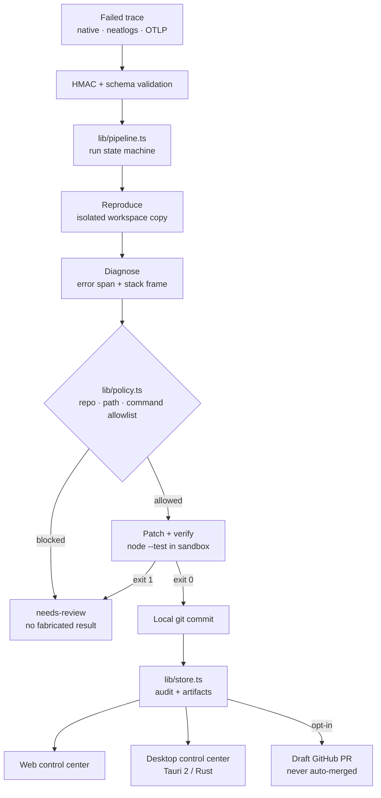

# TraceHealer — Hackathon Submission

## One-line pitch

TraceHealer turns a failed AI-run trace into a reproduced failure, a minimal policy-checked patch, and a verification-gated review artifact — and it never merges customer code.

## Problem

When a production AI agent fails, an engineer starts from a trace and still has to reproduce the failure, find the cause, write the patch, run the tests, and package the evidence by hand. That work is mechanical, repetitive, and easy to fake with a confident-looking "fix" that was never verified. Most tooling stops at telling you *something* broke; none of it hands you a change you can actually trust.

## Solution

A server plus a desktop control center that close the loop with evidence at every step:

1. **Ingest** — a failed trace arrives from the webhook, the API, or a seeded incident.
2. **Reproduce** — the failure is replayed in an isolated workspace with the real failing input, not a simulation of it.
3. **Diagnose** — the stack frame is mapped onto repository context.
4. **Patch** — the smallest safe change is generated and checked against policy (allowlisted repositories, allowlisted paths, protected files such as CI config, lockfiles, package scripts, and tests).
5. **Verify** — the failed input and regression checks run in isolation; the run only reports `healed` if verification passes. The proof shown is the real sandbox exit-code transition.
6. **Package** — a draft review artifact with timeline, checks, logs, diff, and verification JSON. An engineer reviews and merges; **TraceHealer never auto-merges**.

Anything the pipeline cannot honestly fix settles as `needs-review` instead of a fabricated success.

## Why it matters

The valuable autonomous boundary is *diagnosis plus verified proposal*, not merging. An engineer gets a reproduced failure, a one-file diff, and a machine-checkable proof that the original input now passes — in seconds instead of an afternoon — while the merge decision, the one that carries production risk, stays human.

## Three-minute judge flow

1. Open the incident view: the failing trace shows `agent.run` errored, the failing span `order.normalize`, and the real stack (`TypeError: Cannot read properties of undefined (reading 'email')`).
2. Press **Heal this incident**. The card is driven by server state, not a client timer: `Running` → `Verifying` → `Run settled`.
3. The result panel shows all four verification checks passing and the sandbox exit-code transition `before exit 1 → after exit 0`.
4. Open **Healing runs** → run detail: timeline, context files, checks, metrics, delivery attempts, bounded logs, and the diff.
5. Press **Publish** with no GitHub token configured: it fails honestly with "GitHub publishing is not configured" instead of pretending to work.
6. Show the desktop control center connected to the same server, then the unsigned preview downloads.

## Verified result

| Check | Result |
|---|---|
| Original failing test | exit code `1` |
| Same test after the repair | exit code `0` |
| Regression checks | `4/4` passed |
| Artifacts produced | `.patch`, verification JSON, audit timeline |
| Delivery | draft-only review artifact, never auto-merged |

## Architecture

The bundled demo runs against a trusted in-repository fixture in a copied workspace, which keeps the zero-secret demo fast and deterministic. Anything handling untrusted customer repositories belongs in the optional Docker sandbox provider, which is proven against real containers.

## Safety model

1. Incoming payloads cannot select commands or local filesystem paths.
2. The observed failure must reproduce before any patch is trusted.
3. No green replay means no publication.
4. The default strategy runs a fixed, bounded test command in a copied workspace.
5. GitHub publication creates a draft only; TraceHealer never merges.
6. Unsupported traces remain `needs-review` and receive no fabricated after-metrics.
7. Tokens, URLs, raw credentials, and secrets never appear in status responses.
8. Every run, artifact, and control action is tenant-scoped and role-checked; `local` authentication is development-only and fails closed in production.
9. A cross-tenant identifier returns `404`, so runs and artifacts cannot be enumerated across tenants.

## Desktop application

A cross-platform control center (Windows, macOS, Linux) for a TraceHealer service **you run yourself**. It is not a standalone offline repair engine; with no server configured it reports the server as unavailable rather than pretending to work.

The session token lives in the OS credential vault. Only non-secret preferences are written to the app's settings file. Preview installers are unsigned and have no auto-updater.

## Technologies used

Next.js 16 (App Router) · React 19 · TypeScript · Zod · Vitest · Playwright · Tauri 2 (Rust) desktop client · OS credential vault · Docker with a hardened non-root runtime · GitHub Actions across Windows, macOS, and Linux.

## Live integrations

None. No external provider in this build was exercised against live infrastructure, and none is claimed as live-verified.

## Unconfigured integrations

neatlogs (ingestion implemented, no live credentials) · GitHub (draft-PR delivery implemented, fail-closed when unconfigured) · Slack (notification provider implemented) · OIDC (endpoints implemented, unconfigured and refuses with `503`) · model providers (deterministic zero-secret default, no key configured) · Docker sandbox (implemented and proven locally, opt-in) · AWS / remote worker · Entire.

## Demo and downloads

- Repository: <https://github.com/sumitagg24/tracehealer>
- Unsigned preview release: <https://github.com/sumitagg24/tracehealer/releases/tag/v0.1.0-rc.1>
- Talk track: [`docs/DEMO_SCRIPT.md`](DEMO_SCRIPT.md)
- Windows installed-runtime evidence: [`docs/WINDOWS_SMOKE_TEST.md`](WINDOWS_SMOKE_TEST.md)

## Evidence

| Claim | Evidence | Status |
|---|---|---|
| Failure reproduced | Original test exits non-zero in the isolated workspace, before any patch is applied | Verified |
| Repair verified | Sandbox exit code `1` → `0`, `4/4` regression checks pass | Verified |
| Server test suite | `199` tests across `29` files, 0 failures | CI-verified |
| Browser E2E | `13` Playwright tests passed against the production build | CI-verified |
| Desktop renderer tests | `62` tests, 0 failures | CI-verified |
| Desktop Rust tests | `99` test functions in source; `cargo test` is not wired into CI, so the execution result is a local clean-clone run | Local, not CI-gated |
| Desktop CI | Windows, macOS, and Linux legs green, producing real installers | CI-verified |
| Container isolation | No network, read-only root, non-root user, no Docker socket, no server env | CI-verified |
| Windows installed runtime | MSI installs (status 0); the installed app launches, connects to a separately running server, renders incidents, run detail, readiness, and live progress; uninstall returns status 0 with no leftover process, directory, or registry entry | Partially verified |
| macOS/Linux packages | Built and uploaded by CI | Build verified only |
| GitHub repair delivery | Contract tests; draft-only, never merged | Contract-tested, not live-verified |
| neatlogs ingest | Contract/sanitized fixture | Not live-verified |
| OIDC | Fail-closed boundary answering `503` when unconfigured | Unconfigured |
| Signing / notarization | None | Blocked |

The Windows row remains **partially verified**. The packaged app was not exercised for: tray actions, native notification delivery and click, OS-level deep links, sign-out and vault cleanup, the server-unavailable surface, or interactive SmartScreen behaviour. macOS and Linux installers were never installed or launched.

## Known limitations

- Installers are unsigned; macOS builds are not notarized.
- External providers are unconfigured and were not exercised against live infrastructure.
- The tag-triggered release path is implemented but has not yet run for a tag; `v0.1.0-rc.1` was assembled by hand from verified CI artifacts.
- Audio / microphone transcription is not implemented.
- The desktop client is not a standalone offline repair engine.

## What comes next

1. Sign Windows installers and notarize macOS builds.
2. Validate tray, native notifications, deep links, vault cleanup, and the offline desktop states.
3. Run installed-runtime smoke tests on macOS and Linux.
4. Connect and verify external providers against real infrastructure.
5. Exercise the tag-triggered release workflow with the next genuine release candidate.
